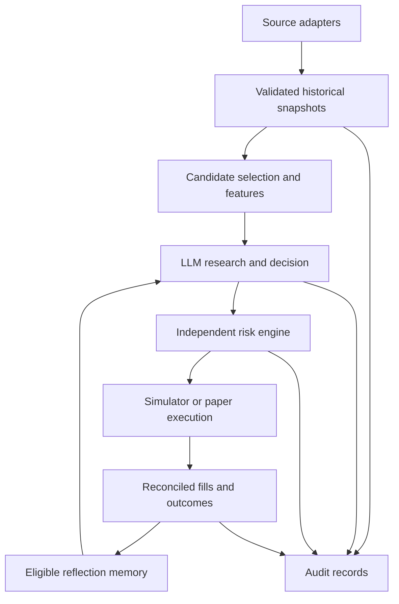
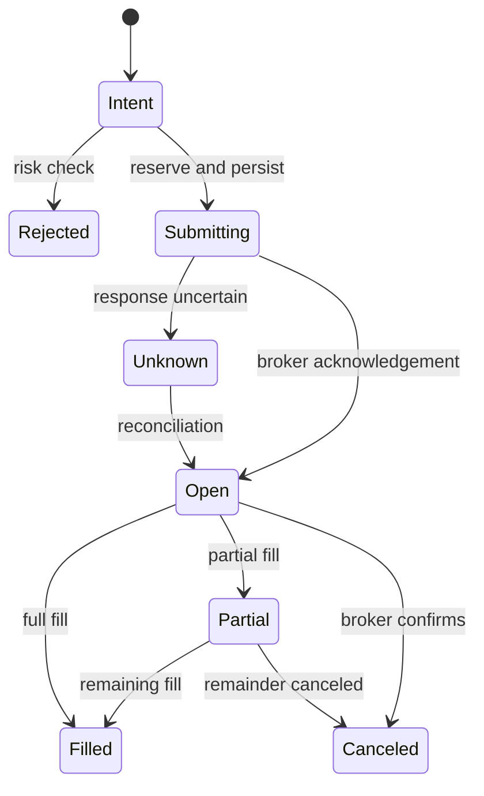

# LLM Stock Trading Agent — Detailed Design

Status: implementation blueprint plus a runnable offline Python starter.
Design date: 2026-10-20. Assignment dates refer to 2026, America/New_York.

## 1. Goal and research questions

Substantially extend the provided notebook into an auditable research system using
Qwen 2.5 1.5B. Test whether complementary financial evidence, reflection retrieval,
SFT/DPO/PPO, and portfolio-level controls improve unseen-period decisions and risk.

Research questions:
1. Does SEC/macro evidence add value beyond price and news?
2. Does retrieval improve decisions, or simply repeat noisy past explanations?
3. Do SFT, same-state DPO, and simulator-based PPO improve generalization?
4. How much apparent improvement is attributable to exposure, costs, or labels?
5. Does the system maintain correct state during outages and ambiguous execution?

Use enterprise practices at student scale: typed contracts, data lineage,
independent risk checks, order reconciliation, immutable experiments and recovery.
Complexity is allowed; each additional component must have a measurable purpose.

## 2. Assignment constraints and assumptions

| Constraint | Implementation consequence |
|---|---|
| Qwen 2.5 1.5B; no larger policy | Keep policy identity fixed; LoRA adapters distinguish experiments |
| Colab Edu Pro L4 only | Profile GPU allocation; use adapters and microbatches |
| Free data sources | Endpoint entitlement checks, quota budget, durable response cache |
| News cached for 24 hours | Reuse snapshot until expiry; do not claim continuous fresh news |
| $100,000 virtual capital | Equal initial capital in replay and paper evaluation |
| Alpaca paper only; no manual trading | No real-money mode, no manually triggered trade decisions |
| Fully operational by November 8 | Integrate, rehearse and select a deployment configuration first |
| Frozen November 9–13 | Freeze weights, prompts, tools, thresholds, schedules and architecture |
| Automatically saved daily logs | Structured event logs plus readable daily ET summaries |
| Preserve notebook baseline universe | Copy all baseline symbols in order, then only permitted additions |

Assumption requiring instructor clarification if challenged: automatic reflection
memory additions are permitted under the frozen retrieval/reflection policy,
consistent with the slides' feedback loop. No manual memory editing in live week.
The notebook uses local MCP-style functions, not a network MCP server. A proper
MCP transport can be added, but the registry alone must not be described as one.

The template's three symbols and weekday calendar are synthetic fixtures, not a
submission-compliant universe or exchange calendar. This is prominently documented.

## 3. Delivered code: what works and what remains

| Area | Included | Extension required |
|---|---|---|
| Demo/data | Seeded replay, purged dataset artifacts, XNYS calendar boundary and a provider-fed yfinance preparation CLI | Historical artifact download and source-coverage rehearsal |
| Evidence | Point-in-time, content-sensitive price/news/SEC/ALFRED normalization | Provider integration rehearsals and live staleness thresholds |
| Snapshots/features | Content-sensitive snapshots; point-in-time returns, SMA, RSI, MACD, volatility and volume features | Market/sector-relative features and training-only normalizers |
| Cache | Canonical identities, SQLite TTL, 24-hour news reuse and raw archives | API budget/backoff and refresh scheduling |
| Memory | Persistent, time-filtered, experiment/run/fold-isolated BM25 ranking | Embeddings and factual LLM reflection generation |
| LLM | Pinned Qwen loader, native chat template sizing, validated bounded tools and redacted transcripts | CUDA model-download rehearsal |
| Risk | Share, cash reserve, gross, position, sector, drawdown and holdings checks | Pending-order reservations, adaptive sizing, correlations, market clock |
| Simulation | Long-only full fills, side-aware costs, incremental outcomes | Corporate actions, partial fills, realistic order types and live/replay parity |
| Training | Locked stack, verified artifacts, LoRA SFT/DPO, native Qwen PPO, checkpoints, audited DPO export, evaluation CLI and CUDA smoke command | Colab CUDA execution on final historical artifacts |
| Live broker | Deliberately blocked paper-broker interface | Outbox, reconciliation, idempotent fill accounting, restart recovery |
| Evaluation | Metrics, benchmarks, confidence intervals, rolling folds, fair-comparison contracts, frozen-test registry and decision-quality evaluation CLI | Completed historical base/SFT/DPO/PPO runs |

`training-plan` describes the executable `agent.training.cli` commands. SFT, DPO and
native token-level PPO are implemented, while the actual Qwen download/CUDA smoke and
historical training runs still require Colab artifacts. Paper broker submission remains
deliberately unavailable until outbox/reconciliation is implemented. The offline demo
continues to use `DemoPolicy`.

## 4. Architecture and dependency boundaries



The LLM cannot submit orders. Source adapters cannot change the portfolio. Tool
closures bind an immutable as_of cutoff; model-supplied arguments cannot advance
it. Execution depends on reconciled broker state, not model claims about holdings.
Future files must not be exposed to policy tools just because replay can load them.

Suggested module extraction as the single-file template grows:

```text
agent/
  contracts.py       # Evidence, Snapshot, Decision, OrderIntent, Fill, Episode
  config.py          # validated immutable experiment and deployment settings
  data/              # prices, alpha_vantage, sec, alfred, cache, features
  retrieval/         # lexical/BM25/hybrid ranking, reflection generation
  policy/            # Qwen loader, schemas, prompt packing, tool loop
  execution/         # risk, sizing, simulator, alpaca_paper, reconciliation
  training/          # SFT dataset, DPO pair generation, PPO environment/trainer
  evaluation/        # folds, baselines, metrics, ablations, reporting
  persistence/       # event store, order outbox, checkpoints, manifests
```

## 5. Data contracts and historical validity

### 5.1 Evidence and snapshots

Evidence contains id, source, symbol, observed_at, available_at, retrieved_at,
text, numeric values and source URL. Add provider revision/accession/vintage IDs,
units, missingness, entitlement/feed, raw content hash and transformation version.

Snapshot contains snapshot_id, as_of, universe version, ordered evidence IDs,
feature version, account state, source-health statuses and market session ID.
Preserve the exact compact evidence sent to the policy in addition to raw inputs.

Observed time is the economic event or bar time. Availability is the earliest
verified publication/release time relevant to the policy. Retrieval is the time
we downloaded the record. Downloading an archive today is allowed only if the
record preserves historical versions; it does not make a latest revised value
historically valid. When only publication dates exist, use a documented
conservative delay. Never invent an intraday release time.

A daily OHLCV bar is unavailable until it closes. Historical account marks must
use prices available at that decision, even though execution can access later bars.

### 5.2 Price and reference data

Use yfinance as the notebook-compatible historical adapter, with explicit start,
end and adjustment policy. Download raw OHLC and corporate-action metadata for
execution accounting; if adjusted series are used for features, document their
construction and retain raw execution units. Do not mix split-adjusted quantities
with raw prices. Model dividends consistently for strategy and benchmarks.

The implemented baseline retains provider adjusted close only on the transient
adapter bar for audit/archive handling and excludes it from historically eligible
evidence, identities and policy payloads because Yahoo can retrospectively revise
adjustments. Feature prices instead form a point-in-time total-return series from
raw closes plus only split/dividend events already eligible at the decision cutoff.
The adapter requires externally verified exchange session bounds and never infers
an intraday close from a date-only provider index.

Add exchange session/calendar data, timezone/DST handling, tradability, symbol/CIK
mapping and sector classification. Use effective-date versions where available.
The fixed whitelist itself creates survivorship bias; disclose it rather than
claiming the current list is a historically selected universe.

Features: trailing returns, moving averages, RSI, MACD, realized volatility,
relative volume, market/sector-relative performance. Fit normalizers on training
only. Benchmark information must also be available before the decision cutoff.

### 5.3 News

Alpha Vantage news adapter: validate endpoint entitlement, handle pagination,
deduplicate by canonical URL/content hash, preserve publication time and source.
Keep relevance-weighted sentiment, article count, age, disagreement, source IDs.
A multi-ticker query may have intersection semantics; verify provider behavior,
and do not assume comma-separated tickers mean independent union searches.

Cache key: source + canonical sorted/deduplicated symbols + all material query
parameters + as_of/window + transformation version. Keep original user ordering
separately if relevant. TTL is 24 hours from fetch for the required news snapshot;
keep immutable historical archives beyond TTL. Live as_of values must not create
a new cache identity every few seconds and bypass the intended 24-hour reuse.

Daily news through 23:59 cannot inform a 16:00 close fill. Choose a pre-open news
cutoff for next-open decisions or an after-close cutoff with the following session
as execution. The simulator and live schedule must express the same convention.

Default budget assumes standard free quota, not an unapproved educational
extension. Do not persist provider messages that echo API secrets.

### 5.4 SEC filings and fundamentals

Use public EDGAR submissions and companyfacts endpoints; obtain ticker-to-CIK
mapping. Follow SEC fair-access guidance and send an identifying User-Agent.
Store accession, form, acceptance timestamp, primary document, section and URL.
Retrieve selected 8-K event evidence plus 10-Q/10-K passages and structured facts.

For each fact retain unit, period start/end, accession and filing availability.
Do not compare annual-to-date cash flow with a quarterly value as if both were
quarters; normalize only with valid accounting logic. Filter amendments and later
restatements. Prefer actual acceptance timestamps; date-only records get an
explicit conservative availability policy. Keep null when definitions disagree.

Retrieval chunks should align with sections/tables, retain units and source IDs,
and remove HTML scripts/boilerplate without losing financial qualifiers. Compute
numeric trends deterministically. Do not label growth an earnings surprise without
an actual historical consensus estimate. Filings provide context, not automatic buys.

### 5.5 FRED/ALFRED macroeconomic data

Use rates, Treasury yields/spreads, inflation, unemployment and credit conditions
as a small initial set. Store series, units, observation period, release date,
vintage, transformation and provenance. FRED latest values may be revised;
ALFRED vintage selection must match the historical cutoff. Where vintage metadata
has dates only, apply conservative release timing rather than assume midnight.
Forward-fill only after release and expose age. Data rights vary by underlying
series; record source terms and keep the set appropriate for project use.

### 5.6 Alpaca market and portfolio data

Source account equity/cash, positions, orders and fills from paper API. Record
feed identity and latency; paper IEX observations are not consolidated US coverage.
Do not assume free Alpha Vantage GLOBAL_QUOTE is real-time. Price freshness
requirements differ from filing/news freshness. Broker reconciliation is the
source of truth for live holdings; local state is a recoverable audit projection.

## 6. Retrieval, research and structured decisions

1. A deterministic screener ranks the permitted universe using trailing data;
   preserve screener version and ties. This selects candidates, not a new whitelist.
2. Fetch/cache a bounded candidate set and holdings, respecting quotas.
3. Retrieve eligible memories, first by BM25 then experimental hybrid ranking.
4. Qwen calls registered tools with validated parameter schemas and bounded budgets.
5. Parse strict structured decisions; verify schema, evidence references and symbol.
6. Record intentional HOLD separately from tool/parse failures and max-turn fallback.

Proposed final schema:

```json
{"symbol":"AAPL","action":"hold","qty":0,"reason":"Signals disagree",
 "evidence_ids":["news:abc","bar:def"]}
```

Retain complete messages, tool calls/results, generated text, validated completion,
raw-to-validated differences and elapsed time in each training episode. The current
wrapper needs transcript instrumentation before SFT collection. Preserve native
Qwen chat formatting and assistant-token boundaries; no handwritten role tokens.

Model context packing must reserve space for final decisions and highest-priority
facts. Never silently truncate every supervised token. Put minimum validity and
risk facts ahead of optional long text; log excluded evidence IDs.

Retrieved text is untrusted. It cannot redefine tools, risk rules, dates or system
instructions. A source reference checks provenance, not whether a reason is true;
add evidence-support audits and adversarial retrieval tests.

## 7. Memory and reflection

Entry: memory_id, experiment/run/fold, situation, source IDs, filled action,
outcome horizon/time, gross/net and incremental results, reflection, uncertainty.
Only entries whose outcome is available by as_of can be retrieved. Start each
comparison from equivalent memory; isolate training, validation, and test folds.
Do not repeatedly replay a test fold with a memory file enriched by future runs.

Baseline: BM25 over structured situation text, top_k=2. Experiments: ticker/sector
filters, recency, numeric regime similarity, semantic embeddings, hybrid fusion.
A static embedding model is an optional non-policy component; verify course
interpretation before adding auxiliary learned models. All variants need a memory
relevance evaluation, not just final P&L.

Reflect factual outcomes; don't say an individual trade earned the entire portfolio
change. Use paired no-new-order portfolio replay for incremental attribution.
A loss can follow a reasonable decision; reflection must separate observation
from causal assertion. Store all outcomes including losses; SFT selection is separate.

Persist pending horizons and reconcile fills first. Only filled quantities enter
reflection; canceled/rejected orders can generate operational lessons, not trade P&L.

## 8. Risk and execution design

### 8.1 Independent policy

Long-only, no leverage initially. Cap per-order shares AND notional position weight;
limit sector and gross exposure, reserve cash, prevent oversells. Thresholds in
Config are illustrative and need validation. Correlation-aware sizing and volatility
scaling are experiments, not implemented claims. Broad ETFs need explicit look-through
policy or separate exposure buckets; sector labels alone do not capture overlap.

New buys pause at drawdown threshold; sells can reduce risk. Decide separately
whether an automated drawdown policy liquidates, cancels, or simply blocks new
exposure. Freeze that choice and distinguish daily from peak-to-date drawdown.

### 8.2 Batch and pending orders

Validate sequentially against a projected portfolio, reserving cash for pending
buys and shares for pending sells. Include all outstanding intents when checking
position/sector/gross limits. Do not accept two individually affordable orders
that jointly exceed capital. A broker fill can gap past an estimate; reject stale
proposals or use a bounded-price execution policy, then monitor actual exposure.
A market fill cannot be guaranteed to respect a pretrade estimate.

### 8.3 Durable order state machine (required before paper integration)



Also model expired/rejected broker states. Unknown blocks affected new orders until
resolved. Persist a stable client_order_id before POST. On timeout do not blindly
resubmit or assume canceled. Query broker by ID, reconcile and retain unknown if
not conclusively resolved. Follow provider timeout guidance; unresolved cases may
require support and leave automation paused rather than manual trading.

Use unique execution IDs to apply fills exactly once. Partial-fill updates change
only the delta, releasing reservations for filled/canceled portions. On restart:
load intents -> fetch broker account/orders -> reconcile -> rebuild reservations
-> mature reflection outcomes -> only then allow new decisions. SQLite transaction
boundaries do not make a network POST atomic; the outbox plus reconciliation bridges
that gap. The delivered simulator's ID dictionary is process-local, not this feature.

## 9. Replay and outcome labels

Core daily convention: close[t] evidence -> next-session open fill -> following
close valuation. Last decision without a complete future horizon is excluded, not
labeled zero/good. All tools share the same decision-time context. Daily replay
cannot establish correctness of an intraday strategy; validate that schedule separately.

Charge side-aware spread/slippage assumptions and fees where applicable. Avoid
double subtracting costs in reward. Price impact, partial fills, limit fill models,
corporate actions and data-feed differences need separate simulations/stress tests.

Record both portfolio change and incremental value versus identical inherited
holdings with no new action through the same horizon. A SELL can help by avoiding
loss, and HOLD must be evaluated as a real alternative. Counterfactual comparisons
assume the simulated path is unaffected by this small portfolio; disclose that.
One-day labels can conflict with multi-day strategy objectives; compare horizons.

## 10. SFT, DPO and PPO

### 10.1 Common controls

All learning uses TRAIN data only. Select checkpoints/reward weights on validation.
Freeze final system before November 9. No live-week parameter updates. Record
exact packages, tokenizer, model revision, prompt/template version, data hashes,
seed, adapter configuration, learning rate, steps, GPU memory and elapsed time.
Trainer APIs change; pin a version after testing compatibility rather than use an
untested notebook install of latest. Never load a different-size teacher policy.

### 10.2 SFT

Start LoRA r=8, alpha=16, dropout=.05, q_proj/v_proj; compare rank and target modules
using a documented budget. No assumption that these defaults are optimal. Train
assistant final decisions with prompt/tool tokens and padding masked to -100.
For trajectory SFT, selectively supervise assistant tool messages; tool results
remain masked. Use native templates and token offsets/assistant masks where supported.
Preserve EOS and nonempty completions, report dropped/truncated examples.

Use actual observed outcomes for selection; compare portfolio versus incremental
labels and valid HOLD examples. Ensure validation/test episodes do not inform
training selection. Log losses and sample generations, not training loss alone.

### 10.3 DPO

Generate multiple feasible responses for the SAME snapshot/account state. Execute
alternatives in independent copies of the same simulator through a common horizon;
rank by a predefined objective including costs/risk. Store prompt, chosen, rejected,
source actions, returns and preference margin. Exclude ties or retain explicit
uncertainty policy. Do not pair unrelated profitable/loss-making dates.

DPO can use future training-period outcomes as labels, but not expose them in the
input. Do not create training pairs using held-out future dates. Compare SFT->DPO
with SFT under fixed evidence, risk, seed budgets and execution assumptions.

### 10.4 Genuine LLM PPO environment

PPO must update Qwen's adapters, not just a separate numeric trading model.
Initialize from SFT, keep a frozen reference policy, and add/train a value estimator
as required by the chosen implementation. A simulator reward can replace a learned
reward model; it does NOT remove the need for advantage/value estimation.

Environment reset: choose a training-only chronological episode with warm-up bars,
initial portfolio, memory seed and pinned evidence. Observation: immutable snapshot,
account, eligible memory and tools. Action: generated decision tokens; tool-trajectory
variant also includes generated research actions. Step: validate -> execute at the
specified later timestamp -> mature outcome -> update memory -> next observation.
Terminate at split boundary, end of episode, or explicitly defined failure state.

Generate FRESH on-policy rollouts from the current adapter, recording old token
log-probabilities, values, masks, rewards, episode done/truncation flags and states.
Reusing a rollout for the PPO update epochs is normal; endlessly replaying old SFT
examples as if newly sampled PPO experience is not. Compute GAE/discounted returns
with correct bootstrapping at time-limit truncation, then optimize clipped policy
surrogate plus value and entropy terms. Track reference KL, clip fraction, entropy,
value loss, explained variance, update ratio and raw reward components.

Initial scope: optimize final decision tokens given fixed tool research. Expanded
scope: train tool selection and full multi-turn behavior. The current Qwen wrapper
uses greedy inference; PPO needs a separate sampled-rollout path with logprobs.
Tool outputs are environment observations, never sampled policy tokens.

### 10.5 Reward experiments

Start with net portfolio log-return; compare benchmark-relative log-return and
incremental no-new-action outcomes. Risk experiments add incremental drawdown or
exposure penalties; invalid proposal penalties remain visible even when validator
blocks the trade. Normalize reward components on training data and bound weights.

Example (illustrative, not a claim of optimal objective):

```text
reward = log(equity_next/equity_now) - log(1 + benchmark_return)
         - lambda_dd * incremental_drawdown
         - lambda_invalid * invalid_proposals
```

Costs already enter equity; do not subtract again. Raw outcomes, risk penalties,
format penalties and KL must be reported separately. Do not use whole-episode
Sharpe as a noisy one-step label without testing its consequences. Compare reward
horizons and sequential portfolio episodes; delay reward until observable.

Test reward hacking: no-trade collapse, hidden invalid actions, repeated tiny trades,
excessive risk late in episodes, tool-budget gaming, and optimizing formatting at
expense of returns. Reaching a simulator cap must not reset losses or manufacture
terminal reward. Reward improvement is not sufficient for deployment selection.

### 10.6 Compute plan and comparative fairness

One L4: LoRA, bounded contexts, rollout microbatches, gradient accumulation,
checkpointing; profile KV cache, reference/value storage and optimizer memory.
Quantization/offload/reference adapter sharing are options to benchmark, not promised
fit. Pause and checkpoint between trials. Do not silently replace Qwen with a larger
cloud model. Compare equal data exposure and separately report wall-time/sample
budgets; sequential SFT->DPO->PPO has greater training cost than SFT alone.

## 11. Evaluation and experiments

Chronological train/validation/test with purged outcome overlap. Freeze normalization
and other learned transforms on train. Build a small number of rolling folds if
historical source coverage permits. Isolate fold memory/cache interpretation.
Record every tried configuration to reduce selective reporting; reserve the final
test for one release assessment rather than tune repeatedly against it.

Benchmarks: cash, SPY buy-and-hold, equal-weight permitted basket, simple momentum,
base Qwen, SFT, SFT->DPO, SFT->PPO, and selected combined sequence. Match starting
capital, dates, execution/corporate-action assumptions and data snapshots. Use
exposure-matched comparisons where sizing explains return changes.

Financial metrics: total/excess return, max drawdown, daily Sharpe (state risk-free
assumption and sample length), downside risk, turnover, gross/net exposure,
concentration, holding durations and realized/unrealized accounting consistency.
Use time-aware/block uncertainty estimates and report seeds, not independent-trade
confidence intervals for correlated overlapping episodes. Five days are not strong
statistical evidence of skill.

Agent metrics: valid schemas, successful tools, source freshness, evidence support,
HOLD/fallback rates, relevant memories, latency, token cost and policy drift.
Operational metrics: duplicate fills applied, unresolved orders, reconciliation
mismatches, recovery time, data gaps, log completeness and uptime.

| Experiment | Comparison | Main question |
|---|---|---|
| Evidence | prices/news + sector, SEC, macro separately/jointly | Complementarity beyond redundant indicators? |
| News | mean vs deduplicated relevance/age/disagreement | Better event interpretation? |
| Memory | BM25 vs filtered/hybrid | Relevant lessons and performance? |
| Risk | caps vs volatility/correlation/exposure | Lower drawdown at comparable exposure? |
| Labels | portfolio vs incremental and horizon variants | Better generalization? |
| Learning | base/SFT/DPO/PPO/sequences | Benefit beyond extra compute? |
| PPO | reward terms, horizon, tool vs final-token training | Stable useful policy change? |
| HOLD | forced activity vs justified abstention | Avoid churn without cash collapse? |
| Execution | 0/5/10 bps per-side plus delay/partial fills | Robustness to assumptions? |
| Operations | timeouts, duplicate events, restart, stale data | Correct state without duplicated exposure? |

Ablations change one component relative to a common enhanced reference; add selected
interaction tests after main effects. Separate failure injection from alpha testing.

## 12. Persistence, monitoring and release control

Use a local SQLite DB for transactions (not a concurrently edited Drive database).
Use the SQLite backup API for consistent checkpoints, then copy completed backups
and append-only JSONL/daily reports to durable storage. Crash windows between broker
and local writes must be resolved through broker reconciliation. Store source raw
responses in content-addressed files with a manifest. Secrets never enter manifests.

Daily ET reports: run/config hash, account opening/closing equity, decisions, tool
failures, order/fill states, P&L/exposure, memory updates, unresolved issues. Internal
times are UTC; market session/day grouping uses America/New_York and an exchange
calendar. Paper broker is authoritative for daily closing holdings and cash.

Freeze manifest: code revision/hash, model/tokenizer revisions, adapter hashes,
prompt hash, tool schemas, feature/retrieval versions, risk limits, schedule,
initial memory digest, dependency lock and approved automatic-memory policy.
Verify manifest on startup; dynamic data and policy-governed memory change, code
and model behavior rules do not. Checkpoints support restart but cannot guarantee
Colab availability. Do not reset the paper account during the evaluation week.

## 13. Acceptance tests and implementation sequence

Delivered tests cover availability cutoff, cache parameter isolation/TTL, memory
run/time isolation, risk/type checks, sequential sector exposure, costs, split purge,
initial-equity drawdown and repeatable demo replay. They do not certify integrations.

Before paper launch also require:
- Golden historical replay: no future news, bar, filing amendment, macro revision.
- Real exchange sessions/holidays/DST and next-session selection.
- Training batches with nonzero supervised tokens and zero prompt/padding loss.
- DPO identical-state pair invariants and reset isolation.
- PPO on-policy masks/logprobs, terminal/truncation handling and reward accounting.
- Cash/share reservations under pending/partial/unknown orders.
- Duplicate callback and restart recovery without a second fill or order.
- Secret redaction, corrupt archive recovery and evidence injection tests.
- End-to-end frozen artifact rehearsal with automatically saved daily logs.

Build order: contracts and historical adapters -> snapshot/feature integrity ->
Qwen loop and BM25 -> real-data replay/benchmarks -> SFT/DPO -> PPO environment and
training -> paper outbox/reconciliation -> fault injection -> final selection and
freeze. These are dependencies, not a restriction on experiment complexity.

## 14. References and API-version notes

Official interfaces consulted 2026-10-20. Verify and lock versions when implementing.
- Assignment: `Assignment_2_Trading_Agent.ipynb`, `AI Trading Agent Intro.pptx`.
- SEC public data APIs: https://www.sec.gov/search-filings/edgar-application-programming-interfaces
- FRED real-time/vintage periods: https://fred.stlouisfed.org/docs/api/fred/realtime_period.html
- Alpha Vantage: https://www.alphavantage.co/documentation/
- Alpaca orders/timeouts: https://docs.alpaca.markets/us/docs/working-with-orders
- Alpaca paper limitations: https://docs.alpaca.markets/us/docs/paper-trading
- HF chat templates: https://huggingface.co/docs/transformers/chat_templating
- TRL DPO: https://huggingface.co/docs/trl/dpo_trainer
- TRL PPO (version-sensitive): https://huggingface.co/docs/trl/main/ppo_trainer
- PPO paper: https://arxiv.org/abs/1707.06347

The unversioned TRL PPO URL did not resolve to a stable trainer page at research
time; use current main/versioned documentation and source inspection before choosing
imports. The template deliberately does not pretend an unverified trainer call works.
